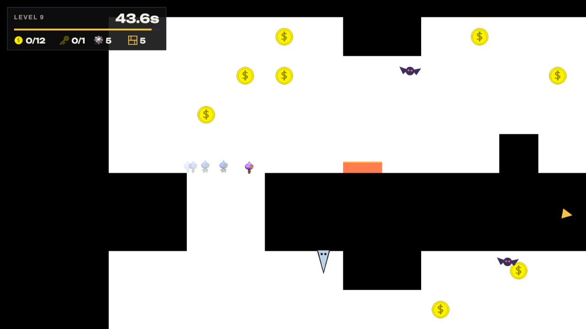
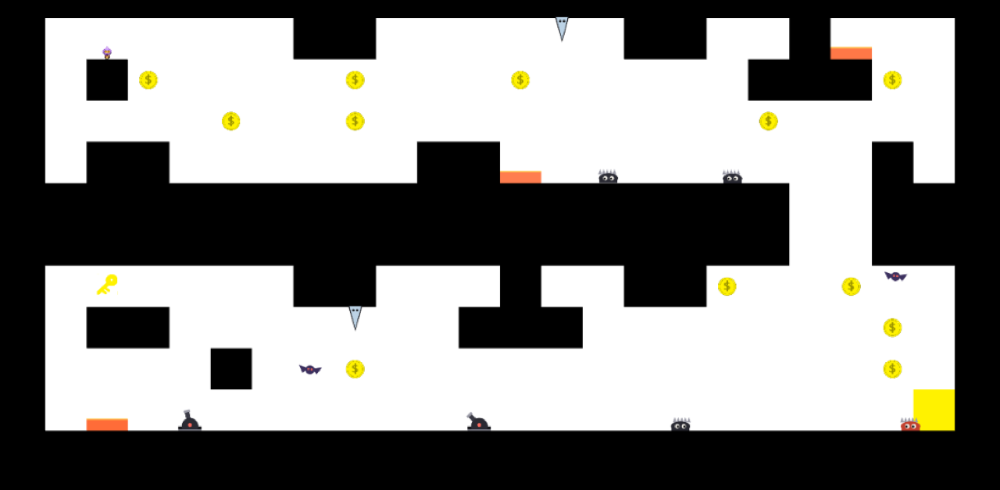
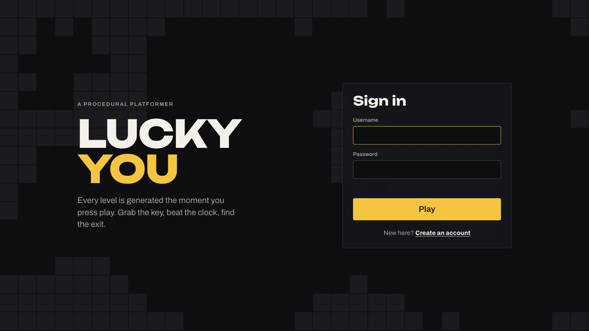
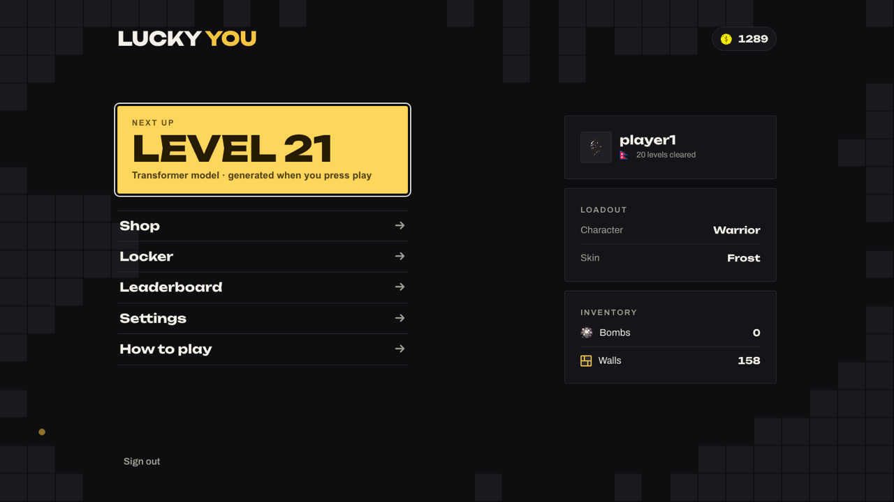
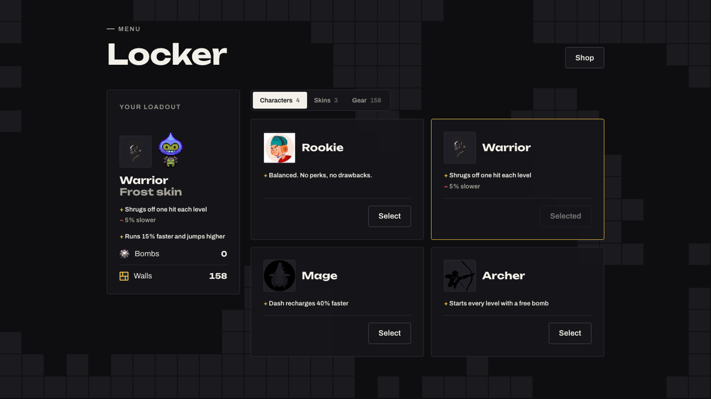
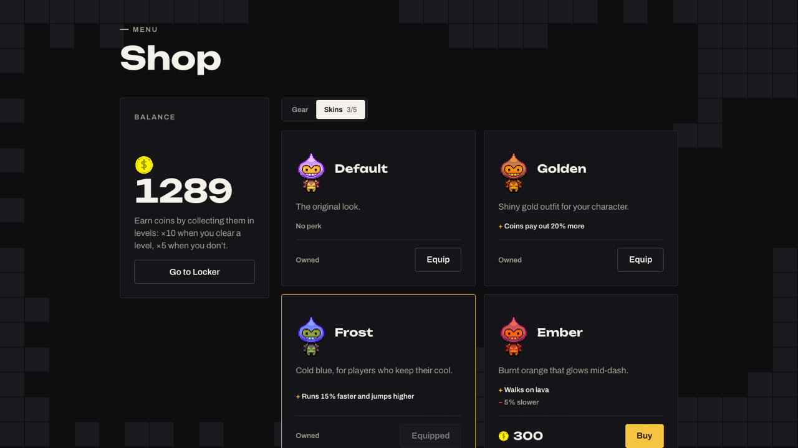
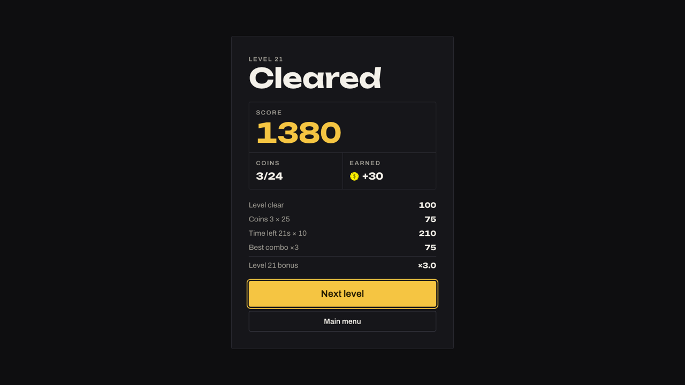
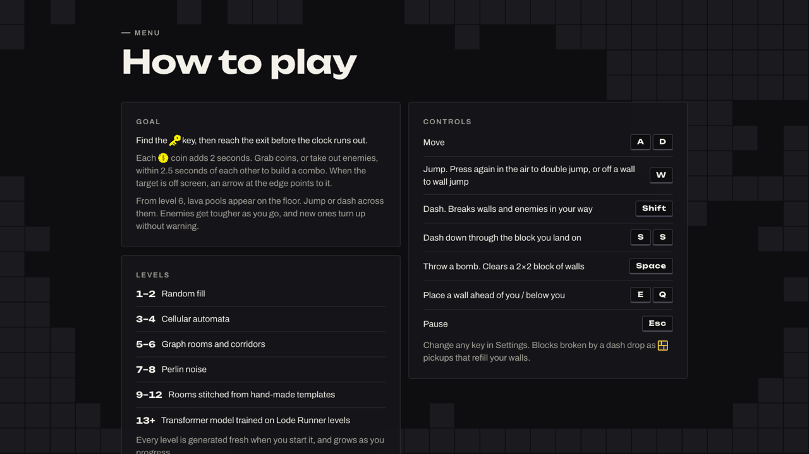

# Lucky You

A fast 2D platformer in which every level is procedurally generated. Grab the
key, collect coins and reach the exit before the clock runs out. As you
progress, each level is built by a different algorithm, and new enemies and
hazards turn up without warning.



This repo is the web client (Phaser 3 + Vite). It is one of three repos:

| Repo | What it is |
|---|---|
| **pcg** (this one) | The game client |
| [PCG-for-game-levels-generation](https://github.com/AwasthiNikhil/PCG-for-game-levels-generation) | Level generators and the Flask API |
| [pcg-db](https://github.com/AwasthiNikhil/pcg-db) | Accounts, scores, shop, skins and the admin dashboard (Laravel 13) |

## Screenshots

A whole generated level, zoomed out. It's a room level (9–12): rooms joined
by drops, with the key on the left and the exit on the right. Cannons,
crawlers, a hunter, bats, icicles and lava pools are spread through it.



| | |
|---|---|
|  |  |
| **Sign in.** Menus sit over a cave backdrop grown by cellular automata. | **Main menu.** It shows the next level and which generator will build it. Fully keyboard navigable. |
|  |  |
| **Locker.** Your loadout is pinned, with tabs for characters, skins and gear. | **Shop.** Skins with perks and drawbacks, bought on the server. |
|  |  |
| **Level complete.** The full score breakdown. | **How to play.** It reads your own key bindings, so a rebind shows up here. |

## Run the whole game locally

The game needs all three repos running: the generator API, the backend and
this client. You need Git, Python 3.9+, PHP 8.3+ with Composer, and Node.

### 1. Get the code

Clone the three repos side by side:

```sh
mkdir lucky-you && cd lucky-you
git clone https://github.com/AwasthiNikhil/PCG-for-game-levels-generation.git
git clone https://github.com/AwasthiNikhil/pcg-db.git
git clone https://github.com/AwasthiNikhil/pcg.git
```

### 2. Level generator (port 5055)

```sh
cd PCG-for-game-levels-generation
python3 -m venv .venv
.venv/bin/pip install -r requirements.txt
cd api && ../.venv/bin/python main2.py
```

Leave it running. Check it with
`curl http://127.0.0.1:5055/generate/8`, which returns a level as JSON.

### 3. Backend (port 8091)

In a new terminal:

```sh
cd pcg-db
composer install
cp .env.example .env
php artisan key:generate
touch database/database.sqlite
php artisan migrate --seed
npm ci && npm run build          # admin dashboard assets
php artisan serve --host 127.0.0.1 --port 8091
```

Leave it running.

### 4. Game client (port 8080)

In a third terminal:

```sh
cd pcg
npm ci
npm run dev -- --host 127.0.0.1 --port 8080
```

Open http://127.0.0.1:8080. Create an account, or sign in as `player1` /
`password`. The admin dashboard is at http://127.0.0.1:8091/admin/login
(`admin@example.com` / `secret123`).

### Stopping

Press Ctrl+C in each of the three terminals.

### Configuration

The client looks for the backends at these addresses:

| Variable | Default |
|---|---|
| `VITE_API_URL` | `http://127.0.0.1:8091/api` (pcg-db) |
| `VITE_GENERATOR_URL` | `http://127.0.0.1:5055` (generator API) |

To point it somewhere else, set them in a `.env` file next to `package.json`.

`npm run build` writes a static build to `dist/`.

Once you've signed in you stay signed in, even across refreshes and browser
restarts, until you sign out. The token is kept in `localStorage`.

## Controls

These are the defaults. You can rebind any of them in Settings, and the How to
play screen always shows your current keys.

| Key | Action |
|---|---|
| A / D | Move left / right |
| W | Jump. Press again in the air to double jump; jump off a wall to wall jump |
| Shift | Dash. Breaks walls and kills enemies in your path |
| S, S | Dash down, breaking the block you land on |
| Space | Throw a bomb (clears 2×2 walls) |
| E / Q | Place a wall block ahead of you / below you |
| Esc | Pause |

Blocks broken by a dash drop as pickups that refill your walls.

In the menus, W/S or the arrow keys move between options, Enter selects, and Esc
goes back to the main menu.

## How a level plays

- Each coin adds 2 seconds to the clock. Coins or kills less than 2.5 seconds
  apart build a combo.
- Under 10 seconds left the music speeds up. An arrow at the screen edge points
  to the key, then to the exit.
- From level 6, single-tile lava pools appear. A jump or a dash always gets you
  across.

### Levels

`src/levels.js` decides which generator builds each level. It also grows the
grid and adjusts the generator settings as the level number goes up:

| Levels | Generator |
|---|---|
| 1–2 | Random |
| 3–4 | Cellular automata |
| 5–6 | Graph (rooms and corridors) |
| 7–8 | Perlin noise |
| 9–12 | Rooms: a Spelunky-style grid of hand-made room templates |
| 13–16 | Transformer trained on Super Mario Bros levels |
| 17 and up | Transformer trained on Lode Runner levels |

### Enemies

The in-game How to play screen doesn't list enemies on purpose: new ones turn
up unannounced. Every enemy gets a little faster each level, up to +50%.

| From level | Enemy | Behaviour |
|---|---|---|
| 2 | Crawler | Patrols its platform and turns at ledges and walls |
| 4 | Cannon | Sits on the floor, aims its barrel at you, flashes before firing, and leads its shots. Fires a 3-shot spread from level 12 |
| 5 | Bat | Hovers, winds up, then dives at you |
| 7 | Hunter | Patrols until it sees you, then chases: hops steps and follows you down ledges |
| 9 | Icicle | Hangs from ceilings and drops when you pass under it |
| 12 | Mimic | Looks like a coin until you get close |
| 15 | Phantom | Drifts through walls toward you |

Dashes and bombs kill every enemy type.

## Scoring and coins

`src/scoring.js` scores each cleared level:

```
(100 + 25 per coin + 30 per enemy + 10 per second left
 + 25 × best combo + 100 for every coin) × (1 + 0.1 × (level − 1))
```

The level-complete screen shows the breakdown. The leaderboard adds up each
player's best score per level, so replaying a level can only raise it.

Coins you pick up pay out ×10 when you clear the level and ×5 when you don't.
The server rejects scores above the maximum possible for a level (see
`app/Support/Scoring.php` in pcg-db). Keep the two files in sync.

## Characters, skins and perks

Characters are free to switch. Skins are bought in the Shop. You change both in
the Locker. Perks are defined in `src/perks.js` and apply in game.

| | Perk | Drawback |
|---|---|---|
| Rookie | None | None |
| Warrior | Shrugs off one hit each level | 5% slower |
| Mage | Dash recharges 40% faster | None |
| Archer | A free bomb every level | None |
| Golden skin | Coins pay out 20% more | None |
| Frost skin | 15% faster, jumps higher | None |
| Ember skin | Walks on lava | 5% slower |
| Shadow skin | Enemies only notice you up close | 10% slower |

## Interface

The menus are HTML layered over the canvas. They share one design system:

- `src/ui/ui.css` holds the tokens and components.
- `src/ui/dom.js` holds helpers for mounting screens, toasts, icons, Esc and
  keyboard focus, tabs, and the generated backdrop behind every menu.

Colours come from the game world: ink walls, paper floors, gold coins. The
fonts are Unbounded for display and Archivo for interface text.

## Code map

| Path | Contents |
|---|---|
| `src/main.js` | Phaser config and the scene list |
| `src/config.js` | Backend URLs |
| `src/api.js`, `src/session.js` | API requests; staying signed in |
| `src/levels.js` | Level progression and the generator request |
| `src/scoring.js` | Level score and coin payout |
| `src/perks.js` | Characters, skin perks and the combined loadout |
| `src/scenes/` | Login, Register, MainMenu, Game, LevelComplete, Shop, Locker, Settings, Leaderboard, Help, PauseMenu |
| `src/gameObjects/` | Player, projectiles, and the crawler, cannon and hunter |
| `src/gameObjects/enemies/` | Enemy base class and line of sight; bat, icicle, mimic, phantom |
| `src/ui/` | Design system and interface helpers |
| `public/assets/` | Sprites, audio, avatars and flags |
| `public/phaser.js` | Phaser, loaded as a global script |
